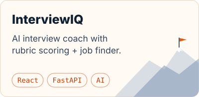
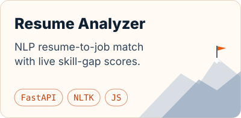
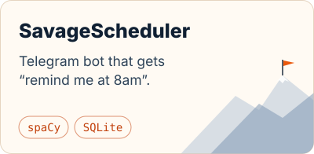

<picture>
  <source media="(prefers-color-scheme: dark)" srcset="assets/hero-night.svg">
  
</picture>

   

I'm a CS student at AKGEC who likes turning AI ideas into products people can actually use.

- 🏔️ &nbsp;Currently climbing: **[InterviewIQ](https://github.com/harshgupta257/InterviewIq)**, an AI interview coach
- 🧠 &nbsp;Exploring NLP, ML pipelines and LLM apps
- 🧗 &nbsp;One LeetCode problem a day, every day
- 🤝 &nbsp;Open to internships and collaborations

 

  <picture>
    <source media="(prefers-color-scheme: dark)" srcset="https://skillicons.dev/icons?i=py%2Cts%2Cjs%2Ccpp%2Creact%2Cfastapi%2Cpostgres%2Csupabase%2Csklearn%2Csqlite%2Cgit%2Clinux&theme=dark&perline=12">
    
  </picture>

 

  <a href="https://github.com/harshgupta257/InterviewIq"><picture><source media="(prefers-color-scheme: dark)" srcset="assets/card-interviewiq-night.svg"></picture></a>
  <a href="https://harshgupta257.github.io/smart-resume-analyzer/"><picture><source media="(prefers-color-scheme: dark)" srcset="assets/card-resume-analyzer-night.svg"></picture></a>
  <a href="https://github.com/harshgupta257/SavageScheduler_Bot_2.0"><picture><source media="(prefers-color-scheme: dark)" srcset="assets/card-savage-scheduler-night.svg"></picture></a>

 

<picture>
  <source media="(prefers-color-scheme: dark)" srcset="https://raw.githubusercontent.com/harshgupta257/harshgupta257/output/contribution-range-night.svg">
  
</picture>

my commits as mountains: one peak per week, redrawn daily by <a href="scripts/mountains.py">a little script</a>

<picture>
  <source media="(prefers-color-scheme: dark)" srcset="assets/footer-night.svg">
  
</picture>
