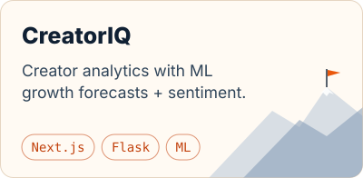
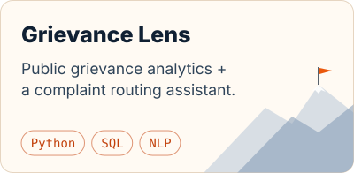

<picture>
  <source media="(prefers-color-scheme: dark)" srcset="assets/hero-night.svg">
  
</picture>

   

I'm a CS student who likes turning AI ideas into products people can actually use.

- 🏔️ &nbsp;Currently climbing: **[InterviewIQ](https://github.com/harshgupta257/InterviewIq)**, an AI interview coach
- 🚩 &nbsp;Just shipped: **[Grievance Lens](https://grievance-lens.onrender.com)**, analytics on India's public grievance data + a complaint assistant
- 🧠 &nbsp;Exploring NLP, ML pipelines and LLM apps
- 🧗 &nbsp;One LeetCode problem a day, every day
- 🤝 &nbsp;Open to internships and collaborations

 

  <picture>
    <source media="(prefers-color-scheme: dark)" srcset="https://skillicons.dev/icons?i=py%2Cts%2Cjs%2Ccpp%2Chtml%2Ccss%2Creact%2Cnextjs%2Cvite%2Ctailwind%2Cfastapi%2Cflask%2Cpostgres%2Csupabase%2Csqlite%2Csklearn%2Cdocker%2Cgithubactions%2Cvercel%2Cbun%2Cgit%2Clinux&theme=dark&perline=11">
    
  </picture>

  
  
  
  
  

 

  <a href="https://github.com/harshgupta257/InterviewIq"><picture><source media="(prefers-color-scheme: dark)" srcset="assets/card-interviewiq-night.svg"></picture></a>
  <a href="https://creator-iq-gules.vercel.app/"><picture><source media="(prefers-color-scheme: dark)" srcset="assets/card-creatoriq-night.svg"></picture></a>
  <a href="https://grievance-lens.onrender.com"><picture><source media="(prefers-color-scheme: dark)" srcset="assets/card-grievancelens-night.svg"></picture></a>

 

<picture>
  <source media="(prefers-color-scheme: dark)" srcset="https://raw.githubusercontent.com/harshgupta257/harshgupta257/output/leetcode-range-night.svg">
  
</picture>

my <a href="https://leetcode.com/u/user0498vT/">LeetCode</a> grind as mountains: one peak per week, redrawn daily by <a href="scripts/mountains.py">a little script</a>

<picture>
  <source media="(prefers-color-scheme: dark)" srcset="assets/footer-night.svg">
  
</picture>
