<a id="top"></a>

<picture>
  <source media="(prefers-color-scheme: dark)" srcset="assets/hero-night.svg">
  
</picture>

<div align="center">

[](https://linkedin.com/in/harsh-gupta0025)
[](https://linkedin.com/in/harsh-gupta0025)
[](mailto:harshg.pro257@gmail.com)
[](https://harshgupta257.github.io/smart-resume-analyzer/)

**[🥾 Trailhead](#trailhead "Who's climbing")** ·
**[⛰️ The ascent](#ascent "Experience, camp by camp")** ·
**[🧭 Routes](#routes "Projects")** ·
**[🎒 Pack list](#pack "Tech stack")** ·
**[🏔️ My range](#range "Contributions as mountains")** ·
**[🔥 Daily climbs](#leetcode "LeetCode")**

</div>


<a id="trailhead"></a>

## 🥾 Trailhead

> [!NOTE]
> **Engineering at the intersection of AI, NLP and data automation.**
> B.Tech Computer Science student @ AKGEC (2023–2027), building production-ready web apps,
> custom NLP intent classifiers and scalable data pipelines.

```yaml
# ~/expedition/climber.yml
climber:      Harsh Gupta
basecamp:     Ghaziabad, India
training:     B.Tech CSE @ Ajay Kumar Garg Engineering College (2023 – 2027)
latest_camp:  Data Analytics Intern @ Pratinik Infotech (Jul – Sep 2026)
gear_focus:   [Python application dev, NLP pipelines, machine learning, REST APIs]
expeditions:  [GSSoC '24 contributor, Buildspace S5 cohort, ex-Head of HR @ Apna IPU Wallah]
daily_climb:  solving algorithm problems and shipping full-stack AI products
```


<a id="ascent"></a>

## ⛰️ The ascent

<sub>Highest camp first. Click a camp to open its log.</sub>

<details open>
<summary><b>▲ Oct 2026 · Camp IV · Shipped InterviewIQ</b></summary>
<br>

An AI interview coach: paste a resume and a job description, answer **8 tailored questions**,
and get each answer scored on a **4-dimension rubric**. The backend computes the percentage,
never the model. An **AI Job Finder** matches real listings to your resume.
→ [harshgupta257/InterviewIq](https://github.com/harshgupta257/InterviewIq)

</details>

<details>
<summary><b>▲ Jul – Sep 2026 · Camp III · Data Analytics Intern @ Pratinik Infotech</b></summary>
<br>

Built a social-media analytics web app, ETL pipelines and KPI dashboards.

</details>

<details>
<summary><b>▲ 2024 · Camp II · GirlScript Summer of Code · Buildspace S5</b></summary>
<br>

- **GSSoC '24, open-source contributor:** resolved issues, reviewed code and added features in Python repos.
- **Buildspace S5, global cohort member:** rapid prototyping and shipping AI projects within sprint timelines.

</details>

<details>
<summary><b>▲ 2024 – 2025 · Camp I · Head of Human Resources @ Apna IPU Wallah</b></summary>
<br>

Talent acquisition, team coordination and cross-functional operations.

</details>

<details>
<summary><b>▲ 2023 · Base camp · B.Tech CSE @ AKGEC</b></summary>
<br>

Ajay Kumar Garg Engineering College, Computer Science, class of 2027.

</details>


<a id="routes"></a>

## 🧭 Routes I've climbed

<table>
<tr>
<td colspan="2" valign="top">

### 🏔️ InterviewIQ · AI interview coach + job finder
<sub><code>route: React → FastAPI → Supabase (RLS) → Gemini</code></sub>

- **Tailored sessions:** resume + JD analysis, then exactly 8 schema-validated questions (technical, project deep-dive, behavioral, system design or case study, motivation).
- **Honest scoring:** four 1–5 rubric scores with reasons. The percentage is computed by the backend, and a failed evaluation is marked failed instead of faked.
- **AI Job Finder:** upload a PDF/DOCX resume and get real Adzuna listings, each scored 0–100 against your resume, then turn any of them into an interview.
- **Engineering:** JWT verification via JWKS, row-level security, prompt-injection hardening, and 128 backend tests on SQLite and Postgres in CI.

[**💻 Code**](https://github.com/harshgupta257/InterviewIq) &nbsp;
`React` `TypeScript` `FastAPI` `Supabase` `Gemini` `Render`

</td>
</tr>
<tr>
<td width="50%" valign="top">

### 🔍 Smart Resume Analyzer
<sub><code>route: PDF → pdfplumber → NLTK → score</code></sub>

Full-stack AI web app analysing PDF resumes against job descriptions with NLP.

- **FastAPI backend:** a custom `/analyze` endpoint with **pdfplumber** parsing and **NLTK** n-gram stopword filtering against a 200+ skill dictionary.
- **Algorithm:** 70% Jaccard skill similarity + 30% keyword overlap, with real-time feedback.
- **Frontend:** animated SVG score rings and a dark glassmorphic UI, deployed on GitHub Pages + Render.

[**🌐 Live demo**](https://harshgupta257.github.io/smart-resume-analyzer/) · [**💻 Code**](https://github.com/harshgupta257/smart-resume-analyzer)<br>
`FastAPI` `Python` `NLP` `NLTK` `Vanilla JS`

</td>
<td width="50%" valign="top">

### 🤖 Telegram NLP Task Bot · v1 & v2
<sub><code>route: message → spaCy intent → APScheduler</code></sub>

Production Telegram bot with custom intent classification and automated scheduling.

- **spaCy NLP:** intent parsing for natural commands (*"remind me tomorrow at 8am"*).
- **Automation:** an **APScheduler + SQLite** engine with full state recovery after a VPS reboot.
- **v2:** high intent accuracy, structured conversation flows, rich task management.

[**📦 v2**](https://github.com/harshgupta257/SavageScheduler_Bot_2.0) · [**📦 v1**](https://github.com/harshgupta257/SavageScheduler_Bot)<br>
`Python` `spaCy` `APScheduler` `SQLite` `Linux VPS`

</td>
</tr>
<tr>
<td colspan="2" valign="top">

### 📊 End-to-end data science & ML pipelines
<sub><code>route: EDA → feature engineering → model → metrics</code></sub>

Predictive modelling workflows across regression and classification with **scikit-learn**:
cross-validation, hyperparameter tuning, RMSE / F1 / ROC-AUC, and publication-quality
visualisations with **Matplotlib** and **Seaborn**.
`Python` `Pandas` `scikit-learn` `Matplotlib` `Seaborn`

</td>
</tr>
</table>


<a id="pack"></a>

## 🎒 Pack list

<table>
<tr>
<td width="33%" valign="top" align="center">

**🪓 Languages**<br><br>


</td>
<td width="33%" valign="top" align="center">

**🧭 ML · data · NLP**<br><br>


</td>
<td width="33%" valign="top" align="center">

**🪢 Frameworks · infra**<br><br>


</td>
</tr>
</table>

<details>
<summary><b>📜 Trail permits · certifications</b></summary>
<br>

- 🎓 **Machine Learning A–Z** · *Udemy (hands-on Python & R)*
- 🐍 **Python for Data Science & Machine Learning Bootcamp** · *Udemy*
- ⚙️ **Automate the Boring Stuff with Python** · *Udemy*
- 📊 **Data Analysis with Pandas & Python** · *Udemy*

</details>


<a id="range"></a>

## 🏔️ My range

<picture>
  <source media="(prefers-color-scheme: dark)" srcset="https://raw.githubusercontent.com/harshgupta257/harshgupta257/output/contribution-range-night.svg">
  
</picture>

<details>
<summary><b>How this range is drawn</b></summary>
<br>

A GitHub Action ([`contribution-range.yml`](.github/workflows/contribution-range.yml)) runs
[`scripts/mountains.py`](scripts/mountains.py) every day:

- It reads my public contribution calendar from the GitHub GraphQL API.
- **Every week of the last year raises one peak.** Its height follows the square root of
  that week's contributions, so a busy week stands out without flattening the rest.
- The ridge behind it is a 4-week rolling average.
- The busiest week gets the summit flag.

The SVGs are published to the [`output`](https://github.com/harshgupta257/harshgupta257/tree/output)
branch. Fewer commits mean flatter terrain; more commits grow taller peaks.

</details>

<a id="leetcode"></a>

## 🔥 Daily climbs

<div align="center">

<a href="https://leetcode.com/u/user0498vT/">
  <picture>
    <source media="(prefers-color-scheme: dark)" srcset="https://leetcard.jacoblin.cool/user0498vT?theme=nord&font=Nunito&border=0&radius=12&ext=heatmap">
    
  </picture>
</a>

</div>

> [!IMPORTANT]
> **Daily commitment:** solving data structures & algorithms problems on LeetCode every day.
> *Consistency beats intensity.*

<picture>
  <source media="(prefers-color-scheme: dark)" srcset="assets/footer-night.svg">
  
</picture>

<div align="center">

*"Simplicity is prerequisite for reliability."* · Edsger W. Dijkstra


&nbsp; [▲ back to the trailhead](#top)

</div>
